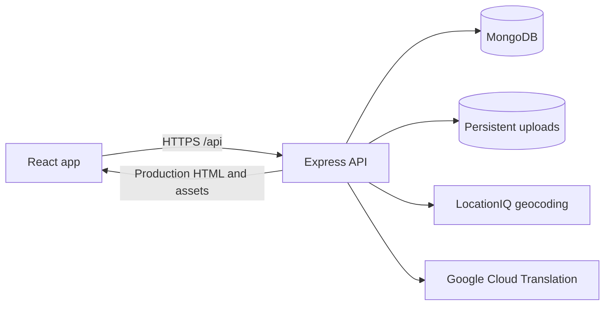

# SnapIt

A MERN travel journal for discovering places, sharing photographs, recording trips, and keeping a private collection of places to visit. The interface includes light/dark themes and achievement cards that flip to reveal milestone details.

## What the app does

- **Discover places:** browse the photo feed, search, open post details, view locations, and search on Google using the magnifier button.
- **Keep a journal:** create places with photos, an address, and a description. Owners can edit/delete their posts; signed-in users can like, comment, and share.
- **Save discoveries:** save a place to Unsorted or a private named collection. Collections support renaming and removal. **Removing a collection also unsaves every place in it**; other collections and Unsorted keep their bookmarks.
- **Record trips:** plan an itinerary/budget, start a trip, add photographed stops and expenses, then stop, review, and publish. Completed trips can be resumed before publication. All places shows an active-trip shortcut while a trip is in progress.
- **Choose trip visibility:** private, followers, or public. The backend checks access to trip details and feeds.
- **Track achievements:** view engagement totals, the next card to unlock, and newly earned cards. Locked fronts are dimmed; fronts contain artwork and backs contain milestone information.
- **Use maps and translations:** LocationIQ resolves addresses, Leaflet displays maps, and Google Cloud Translation translates supported text when configured.

## How it works



In development, Vite serves React on port **3000**, and Express serves the API on port **5000**. In the included production setup, Express serves the built frontend and API together. Browser requests use the deployed site's origin, so the release does not depend on a developer's `localhost:5000`.

React Router handles navigation. Refreshing `/saved` or `/trips/:tripId/review` in production returns the app shell. API routes, missing uploaded images, and missing JavaScript assets retain their own error responses rather than receiving HTML.

### Accounts and sessions

Signup hashes passwords with bcrypt. Login/signup return a signed JWT; the frontend sends it as `Authorization: Bearer ...`. The backend verifies the signature and expiry and derives the user from the token. Public profile responses exclude passwords, email, and saved collections.

Sessions are stored in browser local storage. Expiry clears the session and reloads All places; failed login and ordinary permission errors do not trigger that redirect. Development sessions default to **120 seconds** for expiry testing. Production defaults to **3600 seconds** unless `JWT_TTL_SECONDS` overrides it. Production requires a signing secret of at least 32 characters.

### Places and saved collections

Creating a place uploads PNG/JPEG images and resolves its address to coordinates. MongoDB stores its text, location, owner, image paths, and engagement. Images are files under `Backend/uploads/images`, served through `/uploads/images/...`.

Collections and bookmark references live inside the owning User document. Saved-place endpoints require authentication and operate only on that user's library. Re-saving moves a bookmark rather than creating duplicates. Collection removal atomically removes the collection and its bookmarks. The UI updates counts and bookmark controls after success and retains data when a request fails.

### Trip lifecycle

1. Prepare a local draft with a name, budget, visibility, and itinerary.
2. Start the trip. A unique partial database index enforces one active trip per user.
3. Add stops with up to ten photos, notes, a visited time, and expenses. Location can come from photo GPS, browser geolocation, or address lookup.
4. Stop the trip to review and adjust details, or resume it.
5. Publish the completed trip with a cover photo and visibility setting.

Trip/stop drafts persist locally when browser storage is available. Restoration keeps valid fields and repairs malformed values. Photo files must be selected again after reloading. Repeated submissions are guarded; failed saves retain the form for retry. Browser geolocation requires HTTPS on a public deployment.

### Achievement deck

| Card | Unlock requirement |
| --- | --- |
| Ace | Share one place |
| Ten | Share five places |
| Jack | Receive ten likes |
| Queen | Receive ten comments |
| King | Receive ten shares |

The backend calculates eligibility from the user's places. The frontend shows progress, filters the deck, and remembers revealed cards per account so existing achievements do not replay their reveal on every visit.

### Data and API layout

| Area | Storage / API |
| --- | --- |
| Accounts and follows | User model; `/api/users` |
| Saved places and collections | Private User subdocuments; `/api/users/me/saved` |
| Place posts and engagement | Place model; `/api/places` |
| Trip itinerary, visibility, engagement | Trip model; `/api/trips` |
| Stop photos, dates, location, expenses | TripStop model; `/api/trips/:tid/stops` |
| Translation | Backend provider request; `/api/translate` |

## Local setup

Use **Node.js 24.15+ in the 24.x line** and npm. `.nvmrc` selects Node 24. Use MongoDB Atlas or another MongoDB replica set: place creation and integration checks use transactions.

From the repository root:

```powershell
npm --prefix Backend ci
npm --prefix Frontend ci
if (-not (Test-Path Backend/.env)) { Copy-Item Backend/.env.example Backend/.env }
if (-not (Test-Path Frontend/.env.development.local)) { Copy-Item Frontend/.env.example Frontend/.env.development.local }
```

Edit `Backend/.env` with your database URI and a real JWT secret. Generate a secret locally:

```powershell
node -e "console.log(require('node:crypto').randomBytes(32).toString('hex'))"
```

Run these in separate terminals:

```powershell
npm run start:backend
```

```powershell
npm run start:frontend
```

Open [localhost:3000](http://localhost:3000). Install and build in the same environment: when switching Windows/WSL, reinstall dependencies in the chosen environment rather than sharing native bindings. Both development watchers handle Windows edits while running in WSL.

### Environment configuration

Development secrets belong in `Backend/.env`; production reads `Backend/.env.production` or the host's injected environment variables. Injected variables take precedence. Both files are ignored by Git. Frontend variables are public build-time configuration.

| Backend variable | Purpose |
| --- | --- |
| `DATABASE_API_KEY` | Required MongoDB connection URI; this is the full URI despite its name. |
| `JWT_API_KEY` | Required signing secret; at least 32 characters in production. |
| `NODE_ENV` | Production startup sets this to `production`. |
| `PORT` | HTTP port; defaults to `5000`, or use the port assigned by your host. |
| `JWT_TTL_SECONDS` | Session lifetime: 120 locally, 3600 in production when not overridden. |
| `FRONTEND_ORIGINS` | Comma-separated allowed frontend origins for CORS, without trailing slashes. Set your HTTPS origin when deploying. |
| `MAP_API_KEY` | LocationIQ key, needed for address-based forward/reverse geocoding. |
| `GOOGLE_TRANSLATE_API_KEY` | Google Cloud Translation API v2 key; translation returns 503 until configured. |
| `DATABASE_DNS_SERVERS` | Optional resolver IPs for database DNS troubleshooting; normally empty. |
| `SERVE_FRONTEND` | Serves the build in production; set `false` for an API-only deployment. |

| Frontend variable | Purpose |
| --- | --- |
| `REACT_APP_BACKEND_URL` | Blank uses localhost:5000 in development and the current origin in production. For separate hosting, set an HTTPS backend origin before building. |
| `PUBLIC_URL` | Asset base; leave blank for the included deployment at the domain root. |

Keep local API addresses in `Frontend/.env.development.local`. Use `Frontend/.env.production.local` or build environment variables for a separate production API. Frontend environment changes require rebuilding; backend environment changes require restarting the server. Never put backend secrets in frontend configuration.

## Production deployment

Install both packages and configure `Backend/.env.production` as above. For a local production preview, use an available port such as 8080; on a hosting provider, use its assigned `PORT` instead:

```powershell
npm run build
$env:PORT = '8080'
npm start
```

`npm start` runs `Backend/server.cjs` in production mode, serving `Frontend/build` and the API on `PORT`. Put the process behind managed HTTPS or a reverse proxy and provide durable storage for `Backend/uploads/images`.

For separate frontend hosting, build with `REACT_APP_BACKEND_URL=https://your-api-domain` and publish `Frontend/build`. Configure an SPA fallback to `index.html`. Set `SERVE_FRONTEND=false` on the backend and add the frontend origin to `FRONTEND_ORIGINS`.

## Health checks and verification

- `GET /healthz`: process liveness; 200 while running.
- `GET /readyz`: 200 only while MongoDB is connected and the app is accepting work; otherwise 503. Use this for deployment health checks.
- SIGTERM/SIGINT stops new traffic, drains requests, and disconnects MongoDB. Long HTTP connections close after ten seconds.

```powershell
npm test
npm run test:api
npm run build
npm run test:production
```

Regression/API suites use mocked effects. Production checks exercise the built SPA, deep-route refreshes, asset caching, missing resources, health endpoints, and graceful shutdown with database operations mocked. GitHub Actions runs these checks on pushes and pull requests.

These checks use the configured database:

```powershell
npm run test:database
npm run test:live
npm run test:running
npm run test:saved-database
```

`test:live` performs normal startup/index initialization and read-only API checks. `test:running` checks the backend already serving localhost:5000 to catch stale processes. `test:saved-database` creates isolated fixtures inside a transaction, always aborts it, and verifies that no fixtures persisted. See [PROJECT_AUDIT.md](PROJECT_AUDIT.md) for recorded results.

## Project structure

```text
Backend/
  app.js                  API, health endpoints, lifecycle
  server.cjs              Production entry point
  config/                 Environment and production frontend serving
  controllers/            Request handling
  middleware/             Authentication, IDs, uploads
  models/                 Mongoose schemas
  routes/                 API routes
  tests/                  Regression and integration checks
  uploads/images/         Runtime photographs
Frontend/
  src/places/             Discovery, details, saved collections
  src/trips/              Planning, capture, review, feed
  src/user/               Authentication, dashboard, achievements
  src/shared/             Context, hooks, themes, reusable UI
  public/                 Card artwork and static assets
  build/                  Generated production output
.github/workflows/ci.yml   Automated checks
```

References: [Express health checks and shutdown](https://expressjs.com/en/advanced/healthcheck-graceful-shutdown/) and [Vite deployment](https://vite.dev/guide/static-deploy.html).
